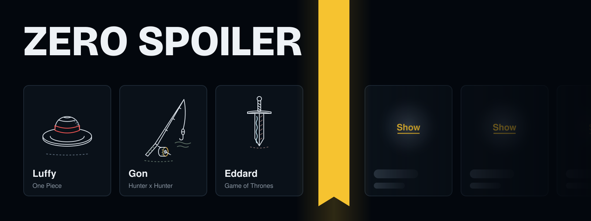
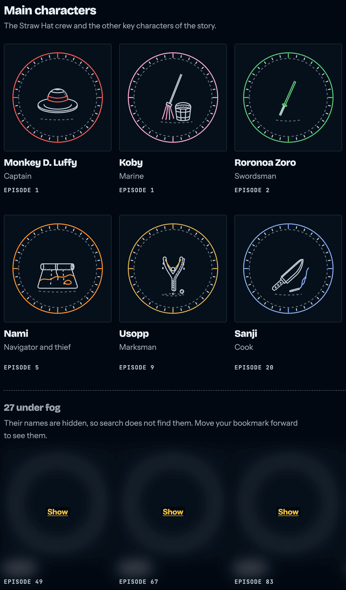
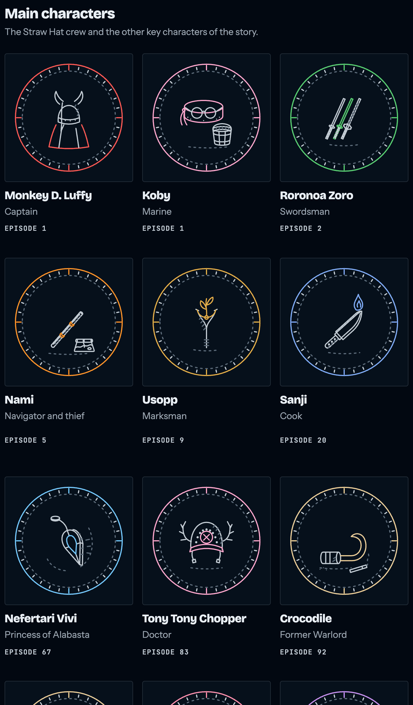
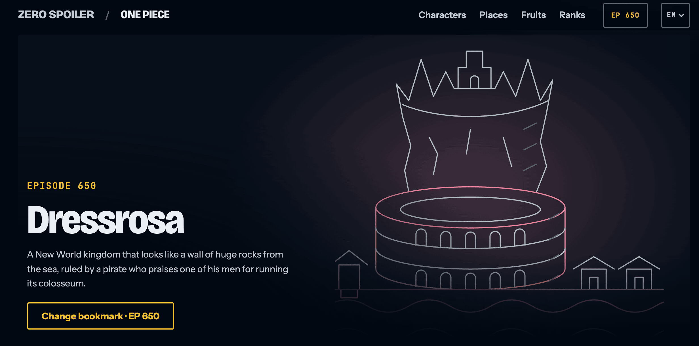
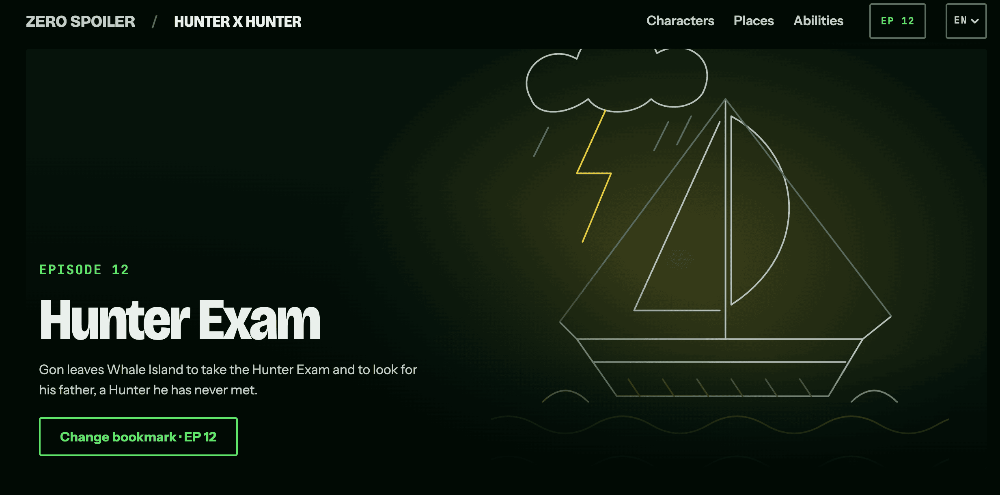
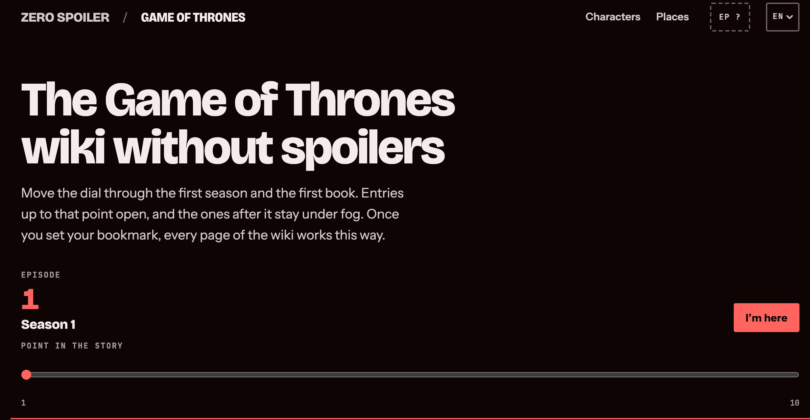
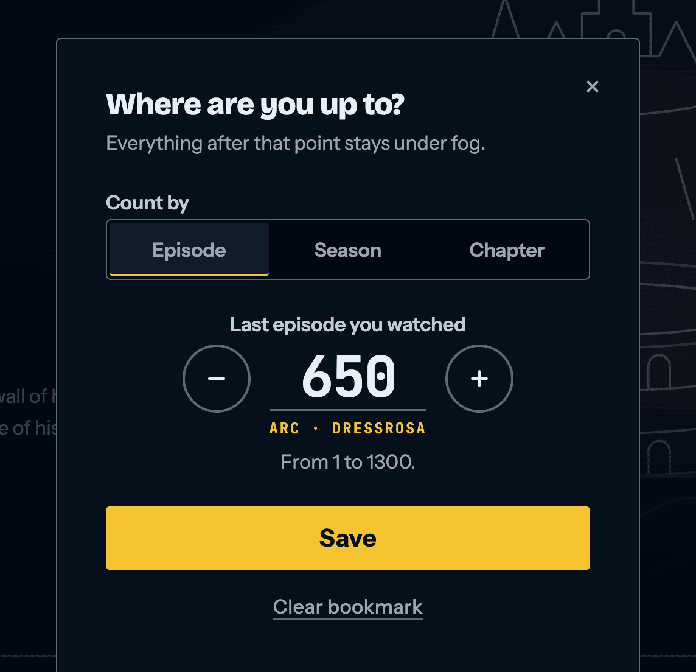

  

<h1 align="center">Zero Spoiler</h1>

  <strong>The wiki without spoilers for One Piece, Hunter x Hunter and Game of Thrones.</strong>
   
  Set a bookmark at the last episode or chapter you reached. Every entry after it stays under fog.

  <a href="https://zerospoiler.app/en"><strong>Open the wiki</strong></a>
  ·
  <a href="CONTRIBUTING.md">Contribute</a>
  ·
  <a href="docs/architecture.md">How it works</a>

  
  
  
  
  

## Same page, two bookmarks

Look up one character on a normal wiki and the sidebar tells you who dies and
who betrays whom. Here you set a bookmark, and every entry after it is under
fog, with its name, drawing and text left out.

| Bookmark at episode 45                                                                                                                                        | Bookmark at episode 650                                                                                                                                                           |
| ------------------------------------------------------------------------------------------------------------------------------------------------------------- | --------------------------------------------------------------------------------------------------------------------------------------------------------------------------------- |
|  |  |

The fog is not a blur in the browser. The server leaves entries under fog out of
the page you receive. The
[architecture notes](docs/architecture.md#fog-on-the-server) show it on the live
site.

## What's inside

- **One Piece**, from the first episode to the latest arc: about 540 characters,
  130 devil fruits and 40 places. The Ranks page shows who holds the ranks in
  about fifteen groups, such as the Emperors and the Marines. When filler is
  close, the landing page warns you, and the Filler episodes page lists every
  one.
- **Hunter x Hunter**, from the Hunter Exam to Kakin, up to its latest chapter:
  about 290 characters, 30 Nen abilities and 40 places. The abilities page
  groups the Nen abilities by Nen type.
- **Game of Thrones**, the first season and the first book, with the second
  season and book being filed: about 210 characters and 75 places.

Every entry has its own line drawing, made for this project, except the newest
Game of Thrones characters, which show a placeholder until theirs is drawn;
there is no official artwork. Some are redrawn from the episode or chapter in
which the story changes them. Search finds only the entries you have reached.
Each series counts in its own units (episodes, seasons, chapters or books), and
the wiki is in English and Italian.

|                                                                                                                                                                                                                                               |                                                                                                                                                                                                      |
| --------------------------------------------------------------------------------------------------------------------------------------------------------------------------------------------------------------------------------------------- | ---------------------------------------------------------------------------------------------------------------------------------------------------------------------------------------------------- |
|  One Piece at episode 650: the arc you are in.                                                   |  Hunter x Hunter at episode 12.            |
|  Game of Thrones with no bookmark: a dial through the first season. |  The bookmark dialog: count by episode, season or chapter. |

## Contribute

The most useful contributions need no code:

- **A wrong episode or chapter.** An entry that opens too early is a spoiler,
  the one bug this project cannot ship. Open a
  [content issue](https://github.com/cosimochellini/zero-spoiler/issues/new?template=content.yml)
  with a source.
- **A redrawing.** Some characters change during the story, and their drawing
  should change with them. Each one is a
  [good first issue](https://github.com/cosimochellini/zero-spoiler/issues?q=is%3Aissue+is%3Aopen+label%3A%22good+first+issue%22)
  with a checklist.

[CONTRIBUTING.md](CONTRIBUTING.md) covers setup, checks, sources and pull
requests.

## Stack

React 19 · TanStack Start (SSR) · StyleX · TypeScript `strict` · Vite · Vitest ·
Cloudflare Workers. Six runtime dependencies, each pinned to an exact version.

## License

[MIT](LICENSE) © 2026 Cosimo Chellini, for the software and original technical
documentation; [LICENSE-SCOPE.md](LICENSE-SCOPE.md) says what it leaves out.
This is an unofficial fan project, not endorsed by the rights holders of One
Piece, Hunter x Hunter or Game of Thrones. Credits, the rights contact, privacy
and sources are on the [legal page](https://zerospoiler.app/en/legal).
