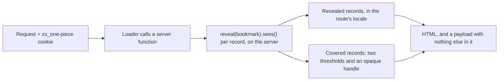

# Architecture

Zero Spoiler is a React / TanStack Start app with StyleX, built by Vite for
Cloudflare Workers. The old Netlify address only redirects to the new domain
(`netlify.toml`). Versions and commands live in `package.json`.

The Worker runs on Workers Free, where Cloudflare kills a request over 10 ms of
CPU. `.github/workflows/worker-cpu.yml` opens an issue on any day it does
(#775).

## Code map

| Path                                     | Responsibility                                                                       |
| ---------------------------------------- | ------------------------------------------------------------------------------------ |
| `src/data/`                              | Server-only archive types, reveal rules, ordering and dated facts.                   |
| `src/data/series/index.ts`               | Registry and lazy archive loading; the only boundary that imports individual series. |
| `src/data/series/<series>/`              | Each series' records, dossiers, drawings and editorial rules.                        |
| `src/server/api.ts`                      | Request-facing server functions.                                                     |
| `src/server/archive/`                    | Filter and project archives into reader payloads.                                    |
| `src/lib/progress/`                      | Public series metadata, bookmark validation and conversions.                         |
| `src/lib/view/`                          | Client-safe payload types and view helpers.                                          |
| `src/routes/`, `src/components/`         | File routes and React UI.                                                            |
| `src/i18n/`, `src/server/copy.server.ts` | Shared translations and server-loaded series copy.                                   |
| `src/styles/`                            | StyleX tokens, series themes and global CSS.                                         |
| `scripts/`                               | Verification, generated documentation and quality gates.                             |

## Spoiler contract

Requests read the selected series' bookmark cookie, load its archive, then use
`readerFor` (`src/server/archive/reader.server.ts`) to keep the archive,
bookmark, source and locale together. `reveal` and dated-field gates decide what
opens. The server returns localized text and drawing strokes only after their
gates.

- Covered records contain only an opaque handle, kind and episode/chapter
  thresholds. Hidden ids, names, prose, links and drawings stay out of payloads,
  HTML, metadata and client chunks. A blurred real record is still a leak.
- Handles belong to a series and its source-filtered archive. Preserve deployed
  One Piece ordinals; other series use their own prefixes.
- Episode and season bookmarks read anime thresholds; chapter bookmarks read
  manga thresholds. Records exclusive to the other source are absent, including
  from counts and handles. Facts exclusive to it stay closed
  (`src/data/source.ts`).
- Without a bookmark, `reveal` opens no records. Onboarding receives the series'
  bounded demo, with every record and dated fact inside both limits. Trial
  cookies are restricted to that demo and yield to a saved bookmark.
- A record page and a list drawn with no bookmark are the one other exception,
  and what they open reads no request header but the cookies: a search engine
  and a person get the same records (#1430). The places chart's orientation is
  the one thing the `User-Agent` decides (below). `pageReader`
  (`src/server/archive/reader.server.ts`) draws a record page at the record's
  own first appearance, and a list (characters, places, fruits, abilities,
  ranks, the filler guide) at the end of the demo, each with `revealAt`
  (`src/data/reveal.ts`): what a reader at the point's episode and one at its
  chapter would both see. The reader keeps the null bookmark and the
  null-bookmark archive copy, so its handles are the ones “Show anyway”
  resolves. A bookmark or a trial gets its own reader, unchanged. Each such
  payload says so (`reads: 'page'` in `src/server/archive/payloads.server.ts`,
  hence its `drawnAt`), and the leak sweep reads every key of it with no
  bookmark, in both locales, held to both of its points (`src/test/visitor.ts`).
- Drawings, search aliases, relationships, place labels and source credits use
  the same gates as prose. Later information belongs in dated entries.
- A record's social pictures (`public/og/`, [Social pictures](#social-pictures))
  are the one exception: static files at addresses built from its slug, so
  anyone who asks for one gets it. The sitemap lists the square of every record
  both sources tell; a record of one source only is not listed. They hold the
  first drawing, and the name and line of the page a link preview fetches with
  no bookmark: the record at its own first appearance, as both an anime viewer
  and a manga reader see it (Hagya's card says Hagya, not the anime's Leol). A
  record of one source only has no page with no bookmark; its card is drawn by
  that source's own reader at the record's threshold. No page under fog names
  them. The fog is an editorial promise kept by the pages, not access control.
- Personalized HTML and archive responses stay out of shared caches. Deferred
  drawings and lists are filtered server-side too; results belong to the
  bookmark they were fetched for.

### Fog on the server

The fog is not a blur over the full page. Ask for a character a reader at
episode 100 has not met (checked on 2026-11-20 against a local build,
`npm run build && npm start`):

```sh
curl -s -b 'zs_one-piece=100' https://zerospoiler.app/one-piece/en/characters/trafalgar-law \
  | grep -c 'Trafalgar Law'
# 0

curl -s -b 'zs_one-piece=100' https://zerospoiler.app/one-piece/en/characters/trafalgar-law \
  | grep -o '<title>[^<]*</title>'
# <title>A character under fog | One Piece | Zero Spoiler</title>
```

With `Cookie: zs_one-piece=650` the title is
`Trafalgar Law | One Piece | Zero Spoiler`. With no cookie at all it is the same
title: the page shows Law as he stands at his first appearance, episode 392,
under a banner that says so (`pageReader`, above). The server reads the bookmark
before it builds the page. An entry the reader has not reached is sent as its
kind, two thresholds and an opaque handle, with no name, no id and no text:



The landing page for a visitor with no bookmark also carries the series’
introduction, East Blue, the Hunter Exam or the first season of Game of Thrones,
so its dial can open and cover those entries in the browser, and nothing past
it.

The archive is never compiled into the client bundle, and `gate:archive` fails
if any of it gets there. Search, drawings and links follow the same rule. The
fog is an editorial promise, not access control: the social pictures above, a
shared link from someone further ahead, “Show anyway” and a record page opened
with no bookmark (drawn at the record's own first appearance) can all open an
entry early ([Security](#security), [Series and routing](#series-and-routing)).

## Relationship selections

`CharacterDossier.relationships` uses complete dated snapshots of at most five
people in editorial order. The server chooses the latest reached snapshot in the
reader’s source/unit and carries it forward without saga-based resets. Only its
selected people are projected; each retains their earlier reached history,
deduplicating unchanged consecutive wording. Removed people and future
selections contribute no cards, counts or placeholders. A later re-selection
restores the pair’s reached history. Both endpoints and each snapshot are gated
before names or text reach the client; perspectives remain directed.

Character pages in every series show reached relationships or omit the section
entirely, including while it loads. The cohort inventories account for every One
Piece and every archived Hunter x Hunter character through authored selections
or documented deliberate omissions; Hunter x Hunter characters filed later wait
under `pending` with the issue that will author them
(`docs/content-provenance/hunter-x-hunter-relationships.json`). The Game of
Thrones inventory accounts for every archived character through authored
selections or documented deliberate omissions; a character filed later waits
under `pending` with the issue that will author it
(`docs/content-provenance/game-of-thrones-relationships.json`). No relationships
are inferred. Character archive-order navigation and nearby recommendations have
been retired, and so has the place page's previous and next stop; a place's map
names the reached stops around it instead. The fruit rails remain.

The authoring contract and provenance requirements are in
[Contributing](../CONTRIBUTING.md#authoring-relationship-selections). Selection
and wording share the existing timeline; no separate client selection API
exists.

## Security

SSR security headers, including the per-request nonce CSP, are set in
`src/security-headers.ts`; static asset headers cannot protect SSR documents. On
the dev server only, the policy also admits `http://localhost:*` for
impeccable's live-mode helper; a production build drops the allowance. Server
functions use the CSRF middleware in `src/start.ts` and read progress from
request cookies, never a client-supplied bookmark.

Fog prevents accidental spoilers, not deliberate access: “Show anyway” reveals a
record by handle, and a record's own page, opened with no saved or trial
bookmark, shows it as it stands at its first appearance. No content or fog
decision reads the `User-Agent`: a crawler and a person with no bookmark are
sent the same records, because answering a crawler differently is cloaking
(#1430). The one exception is layout: the places chart is drawn upright for a
phone (`Mobi` in the `User-Agent`, or `Sec-CH-UA-Mobile`, with a `Vary` header;
`src/routes/$series/$locale/places/index.tsx`), never with more or less open.
See `src/lib/progress/requestBookmark.ts` and `pageReader` in
`src/server/archive/reader.server.ts`.

## Series and routing

All three series are open to readers. Hunter x Hunter files the verified Hunter
Exam coverage through episode 26 / chapter 43, including the manga's chapter-one
characters introduced later by the anime, the Heavens Arena characters and place
up to episode 34 / chapter 59 (#896), and Yorknew City through episode 58 /
chapter 119 (#900): the Nostrade household and bodyguards, the twelve Phantom
Troupe members, five Shadow Beasts, Zepile, Zenji and five places. Greed Island
recruitment (#1016) and arrival/training through chapter 141 (#1017) add
verified named characters and visited places, with source-only records where the
naming evidence reaches only one medium. Alliances and the Bomber revelations
through chapter 159 (#1018) add source-verified names and visited places; the
finale and the full candidate audit (#1019) close the arc. Of the 31 candidates
the audit left unnamed, #1032 files Michael, named at the intercom in chapter
148 (manga-only), and records an owner-ruled exclusion with the missing evidence
for the other 30. Greed Island chronicles cover every character filed through
#1019 and returning characters’ events through episode 75 / chapter 185 (#906),
preserving the records’ source restrictions. Chimera Ant phase 1 (#1020) adds
the opening survey team records, a Royal Guard and NGL. Phase 2 (#1021), through
episode 95 / chapter 222, adds the extermination team and its students, the rest
of the survey team, the NGL villagers, the King, the other Royal Guards and the
Squadron Leaders named so far, and eight visited places, each at the first
chapter and episode whose synopsis names it, with source-only records where only
one medium does. Phase 3 (#1022), through episode 109 / chapter 260, adds the
Squadron Leaders, captains and soldiers named on the road to the palace (Ikalgo,
Meleoron, Welfin, Bloster, Flutter, Remora, Pell, Bihorn), Komugi, Bizeff and
Tsukuma, and four visited places, Meteor City at the Troupe's visit in chapter
224 / episode 96 rather than at its earlier mentions. Hagya keeps one record:
the anime, which never says his manga name, opens it as Leol at episode 106
(`Entity.episodeName`), and the manga gives the name in his role at chapter 240.
Phase 4 (#1023) covers the palace assault through chapter 298, adds Taragetter
in the manga, and opens Peijin in the anime at episode 116. Phase 5 (#1024)
files the finale through chapter 318 and episode 136, with the full cast
reconciliation in the phase 5 inventory. The Chimera Ant Queen, left out of the
phases as a title, is filed for the ranks page (#1447), where she holds the
Chimera Ants' top seat. Chimera Ant chronicles (#910) cover all 46 newly filed
characters and 17 returning characters through episode 136 / chapter 318, with
255 bilingual timeline entries and source-specific versions. Election (#912)
files named characters and visited places through chapter 339 and episode 148,
drawn in #913 with five stages (three deaths, two ability reveals). Election
chronicles (#914) add 91 bilingual stories for all 28 new characters and 15
returning characters, with separate source restrictions for anime-only records
and scenes, and a manga-only item trade. Kakin (#916) is manga-only and files in
five phases; phase 1 (#1134) covers chapters 340–357 and phase 2 (#1135)
chapters 358–370 and phase 3 (#1136) chapters 371–383, phase 4 (#1137) chapters
384–400 and phase 5 (#1138) chapters 401–420, the last published. Phases 1 and 2
are drawn in #1154, with 22 manga-only stages through chapter 370 (eleven
princes' Guardian Spirit Beasts, four deaths, four returning records' reveals,
Hisoka's return, and Chrollo's disguise and its end); phases 3 and 4 are drawn
in #1156, with 14 more stages through chapter 400 (eight abilities first shown,
five deaths or presumed deaths, Kacho's with her beast taking her form, and
Salé-salé's lost beast); phase 5 is drawn in #1158, with 9 more stages through
chapter 420 (four reveals of identity or allegiance, two abilities first shown,
and three deaths). Kakin chronicles for chapters 340–370 (#1155) add 99
manga-only stories for the 45 characters filed there and 20 returning
characters; all sit at episode 148, so the home ledger and the uniqueness test
key a story by its chapter as well. Chapters 371–400 (#1157) add 120 more for
the 40 characters filed there and 44 returning ones, and chapters 401–420
(#1159) 84 for the 22 filed there and 37 returning ones. Candidates whose naming
stays unverified are deferred to #1141–#1145. Gyro is unanchored at 78 / 203.
Silva, Killua's father, is named in episode 24 but in chapter 95 in the manga,
so his record is unanchored at 24 / 95 (#834), as is Chrollo, shown from chapter
71 but named in the episodes only from 53 and filed at 54 / 71 (#900); Kikyo is
named only in credits and supplements, and Hishita only in chapter 329 (#912).
Every Hunter Exam character has a chronicle (#762); the Heavens Arena characters
get theirs in #898. Records are not added from unnamed appearances or
supplemental names.

A Hunter x Hunter character's Nen type is a dated field of its own (`nen`,
`Series.features.nen`, #922), shown as a row of the character's facts in the
series' words. It opens only for a character the story has shown using Nen, as
"not yet known", and every entry is pinned to its true chapter, the first one
included, because it does not open at the record's gate. The Heavens Arena cast
is filed: Water Divination and Wing's lesson tell Gon's, Killua's, Zushi's,
Wing's, Hisoka's, Gido's and Kastro's types at chapter 60 / episode 35; Sadaso
and Riehlvelt stay "not yet known". Later arcs' types are filed with their arcs.

Hunter x Hunter files the named personal Nen abilities shown in Heavens Arena
and Yorknew City at their own gates (#924).

A Nen ability is a record kind of its own (`ability`, #923), Hunter x Hunter's
answer to the devil fruits. It opens at its own threshold, where the story first
shows it, and keeps the Nen type the story has told by then
(`Features.abilities`, `abilityNenOf`); a type told later is not filed, and an
ability with none has no type row. Its users are read off the characters' dated
`ability` entries, like a fruit's eaters: each opens at the later of its entry
and the character, and a covered user is dropped rather than slotted, so no tile
or page counts one. Every entry is pinned to a chapter and opens no earlier than
its ability (`src/data/abilities.test.ts`), and a character's page links only
the abilities the reader has reached. The abilities page has a plate per Nen
type of the open abilities, a plate of the open ones with no type told, and one
fog band for every covered ability, so a band never says a covered ability's
type; an ability's own page is its stage and its reached users.
`hasPage(series, 'abilities')` follows `kinds.includes('ability')`, and Hunter x
Hunter declares the kind for its Heavens Arena and Yorknew City abilities
(#924). The synthetic records in `src/test/abilities.ts` also exercise the
ability pages and their user gates.

Game of Thrones is open to readers (#856), filed in #849: its description (the
show's seasons, the five books, the season 1 / first-book demo), its copy, its
red theme and its hub crown (#850). It files no arcs: each season module is
headed by its own `heading`, and a season with no record is left out of the
engine's sagas until its records land. Season 1 files the main cast of the
season and of _A Game of Thrones_ (#852): 63 characters, the six direwolves
among them, each gated where it appears and is named in each medium, with every
dated step pinned to both an episode and an absolute chapter; Ros, whom only the
show has, is `source: 'episode'`. #1006 adds the 60 recurring characters of
Winterfell, King's Landing, the Vale and the Riverlands, bit parts left out:
those only one medium names in the stage are `source`-only, and those the other
medium meets in a later season or book keep that later gate. #1007 adds 16 of
the Night's Watch and #1008 nine of Daenerys's storyline, by the same rules.
Season 2 and _A Clash of Kings_ (#1455) file by cast group: King's Landing and
the Blackwater (#1463) adds seven characters, one the show's alone and six the
books', each showing a placeholder bust until its drawing child, and the stage's
dated steps of eleven season-1 characters, kept in `season-1.ts`. Stannis, Renly
and the stormlands (#1464) add twelve, one the books' alone, three with the
show's later gate, and Loras Tyrell's stage-2 role steps. Robb's war, the
Riverlands and Harrenhal (#1465) adds nine, two the show's alone, four the
books' and three both media's, with the stage's steps of eight season-1
characters. Winterfell and the Iron Islands (#1466) adds fifteen, seven the
books' alone, Asha Greyjoy filed under the books' name with the show's Yara as
her `episodeName`, and the stage's steps of Theon, Bran, Rickon and Osha. The
Wall and beyond (#1467) adds twelve, seven of them the books' alone, with
placeholder busts too, and stage-2 steps on Jon Snow and Samwell Tarly. The
series opened before its drawings: Eddard, Jon, Daenerys and Tyrion have their
own, with seven stages: Eddard's death and Ice melted, Jon's death, return and
true name, and Daenerys's fire and death from the drawing audit (#1292), the
Winterfell household's are in `art/winterfell.ts` (#854), with 25 stages after
the drawing audit (#1285), the southern cast's are in `art/south.ts` (#1051),
with thirty-seven, sixteen of them the later looks and deaths of #1286 and
eighteen from the drawing audit (#1287), and the Night's Watch's and Essos
cast's are in `art/wall.ts` and `art/essos.ts` (#1052), with twenty, four of
them the deaths of Jeor, Aemon, Alliser and Yoren from the drawing audit
(#1290), six from the drawing audit (#1296) and four those of Jorah, Irri,
Doreah and Rakharo (#1292), and thirteen more of the Watch's in `art/wall.ts`
(#1295), with ten, the places' are in `art/places.ts` (#1053), with fourteen
stages for the damage and rebuilding later seasons and books give (#1236), the
northern household's are in `art/north.ts` (#1054), with fifteen, twelve of them
the deaths, Roose Bolton's allegiance and Jeyne Poole's false identity from the
drawing audit (#1288), the Vale cast's are in `art/vale.ts` (#1055), with two,
the King's Landing cast's are in `art/court.ts` (#1056), with thirteen, twelve
of them from the drawing audit (#1289), and the Riverlands cast's are in
`art/riverlands.ts` (#1057), with ten: six of them the deaths later seasons and
books give (#1242), and the Blackfish's death, Jaqen's coin and Pod's axe from
the drawing audit (#1290). Every stage-1 character has its own drawing; the
stage-2 characters show the shared `PERSON` placeholder until their drawing
children (#1460), and the drawing tests hold the series like any other. Its
places are the 23 a scene of the season or the book is set in (#853) and those
both name without visiting it (#1035: the North's five in #1248, nine of the
Riverlands, the Westerlands and the Vale in #1249, five of the south and the
seas in #1250, Essos's ten in #1251), and eight visited places #853 left out
(#1252), each filed in one of the realms, the Iron Islands, the Reach and the
seas among them, beyond the Wall or Essos, with no arc: `PlaceDossier.arc` is
optional, and an arcless series prints no arc row. Darry and six of #1252's
places are the book's alone, and the Kingswood the show's. The demo shows the
places the first ten episodes reach, and covers in its tail the four the show
first visits in later seasons. Its chronicles cover the Essos cast of the first
stage (#1360), 89 stories for 18 characters, the Night's Watch cast (#1363), 88
stories for 22, the King's Landing, riverlands and Vale cast (#1362), 228
stories for 65, and the Winterfell and northern cast (#1361), 160 stories for
39, in `records/season-1.chronicle.ts`: a story both media tell the same way
holds at an episode and a chapter, and one only a single medium tells, or tells
its own way, carries `source`, so it never reaches a reader of the other. Their
notes are in `scripts/chronicle-sources-got.mjs`, and the chronicle lede is the
series' own copy, since a story starts at an episode or a chapter. The second
stage, season 2 and _A Clash of Kings_ (episodes 11–20, site chapters 74–143),
is being filed under #1455. So far `records/season-2.ts` holds its heading, the
characters filed by cast group above and an empty `SEASON_2_PLACES`; a character
season 1 filed takes its new dated steps in `records/season-1.ts`, and the demo
stays at stage 1.

Public metadata in `src/lib/progress/series.ts` holds cookies, ranges, seasons,
demo bounds, features and themes, without archive records. Pass the series to
bookmark conversions; shared code must not assume One Piece.

The registry separates all filed series (`SERIES` / `filedArchiveOf`, for tests,
gates and scripts) from reader-accessible ones (`OPEN_SERIES` / `archiveOf`). A
filed but closed series is announced by name, serves no archive and has no
sitemap entries. Shared engine and server modules use the registry rather than
importing a series directly. Optional slices are declared through features;
`hasPage` governs page availability, navigation and sitemap membership.

Content routes are `/<series>/<locale>/…`; `/<locale>` is the hub and hosts
legal/privacy pages. Unknown series and locales return 404. A 404 without a
route's own not-found page, and a record route of a section its series does not
declare, is drawn by `NotFoundPage` (`src/routes/-fallback.tsx`): in the series'
shell under `/<series>/<locale>`, where the root still reads the series for the
bookmark provider, and in the shared shell elsewhere. A render error below a
locale layout is drawn by `ErrorPage` in that layout's shell. An error in a
locale layout itself, a series' included, falls back to the shared shell. An
error in the root (its guard, the bookmark provider or that shared shell) is
`RootError` in `src/routes/__root.tsx`: the document, a heading, a sentence and
a reload link, with no bar or footer and without the dictionary. Legacy
locale-first content routes redirect under `/one-piece` before bookmark
parameters are read. `src/start.ts` handles shared-link bookmarks, legacy cookie
migration and the `/` redirect (cookie, then country, then `Accept-Language`)
before loaders. A link to a series page sets the bookmark: `?ep=650` for an
episode, `?s=2&ep=3` for an episode in a season, or `?ch=1044` for a chapter.
Links on the root, legal and privacy pages set no bookmark. The link replaces
the bookmark the reader had, so a link from someone further ahead can open
entries they have not reached. `src/server.ts` is the Worker entry: it adds a
`Link` header for the stylesheet and the fonts the root route preloads, which
Cloudflare replays as a `103 Early Hints`.

## Social pictures

An open record page's head points `og:image` at a wide card
(`/og/<series>/<locale>/<id>.png`, 1200×630: drawing, name, one line, site
name). Its JSON-LD and its sitemap entry point at a square icon
(`/og/<series>/<id>.png`, 600×600). A covered page and every other page keep
`/og-card.png`. `npm run og:images` draws both pictures in Chrome, on the
developer's machine. They are committed under `public/og/` and served as static
assets, so the Worker never draws one. Each picture uses the record's first
drawing, never a redrawing, and prints the name and one line of the page a link
preview fetches with no bookmark (`pageReader`, drawn at the record's first
appearance in both media): a character's epithet, else its role; a fruit's type;
an ability's Nen type, else its kind; a place's form and region; a ship's kind.
So a card says what the page's title says, the record's own name where the anime
names it otherwise (Hagya, not Leol, which the manga gives only at chapter 240),
and `scripts/og-images.test.mjs` holds the two equal for every such record. A
record of one source only has no page with no bookmark; its card is its source's
reader's at the record's threshold. Re-run the script after changing a record, a
first drawing or the card layout. It draws only what changed.
`scripts/og-images.test.mjs` fails while a picture is missing, stale or
orphaned.

## Localization

Use `useT()` for shared dictionary keys and `useSeriesT()` for common series
keys. Feature-specific keys use `useSeriesT('<series>')`, guarded against
`undefined`, or `useSeriesOnlyT('<series>')` in components exclusive to that
series. Shared dictionaries contain no series-specific prose. Series
dictionaries stay server-side and reach only the relevant pages; Italian keys
are typed against English. A series' copy goes to every page at every bookmark,
so gated names do not belong in it: One Piece's faction labels live in
`src/i18n/dictionaries/one-piece/factions.ts` and reach a page only with the
fruit album group an open eater stands in, or, once a body of power is met and
one of its seats is held or vacant, as that body's name on the ranks page and on
the seat links of a character who holds one of its seats (`seatsHeldBy`). Hunter
x Hunter's group names live in `src/i18n/dictionaries/hunter-x-hunter/groups.ts`
and reach a page only the second way. Both tables are a series' `groups` in the
registry (`src/data/series/index.ts`), read through `groupLabel`
(`src/server/archive/printed.server.ts`). One Piece's seas' names live in
`src/i18n/dictionaries/one-piece/seas.ts` and reach the places page only for the
regions its open stops open on the chart (`regionsFor`,
`src/lib/view/chart.ts`), and a place's page or peek for its own sea. The shared
dictionary is one chunk per locale: the root route awaits the copy of the
address's language in `beforeLoad` (`localeOfPath`), for a locale route's page
and for the not-found page of an address no locale route matches, and the router
awaits it before hydrating, so a page downloads its own language only. What
renders above a locale route (`<html lang>`, the shared shell of a not-found
page) reads the language from the root's context, which lands with that copy,
never from the router's location, which moves when a navigation starts. A chunk
that fails to load reloads the page once per tab and address (a `sessionStorage`
flag; without storage, no reload); a hovered link's preload never reloads. If it
fails again, a page that is hydrating deliberately stays as the server rendered
it, while a client-side navigation shows the root's own error page, which needs
no dictionary. The privacy notice (`src/i18n/dictionaries/privacy.ts`) ships
with the legal page alone. Copy rules live in the
[tone-of-voice skill](../.claude/skills/tone-of-voice/SKILL.md).

## Extending the archive boundary

- Describe a new server function once, as an entry of `ENDPOINTS` in
  `src/server/archive/payloads.server.ts`: its input (`src/server/inputs.ts`),
  the bookmark it reads (`reads`), its projection, whether it answers with
  `plain`, and the ids or handles the sweep asks it with (`keys`). Then add its
  wrapper to `src/server/api.ts`: one literal
  `createServerFn().validator(...).handler(...)` that serves the entry, because
  Start's compiler needs one per export. The sweep, the dump and the JSON
  round-trip checks read the same entry. A new entry goes at the end of the
  table, after the deployed ones, so One Piece's sweep and dump stay byte for
  byte: `loadAbilities`, `loadAbility` and `liftAbility` (#923) are the last.
- Register new prose outside a series' `records/` in its `EXTRA.prose` entry in
  `scripts/archive-gate.mjs` and in `textsOf` in `src/data/leaks.test.ts`, using
  the page's actual gate.
- The ranks page (`/{series}/{locale}/ranks`, `/power` until #1194, which
  `movedPageRedirect` in `src/lib/legacyRedirect.ts` answers with a 301 that
  keeps the query for every series with the page) draws the bodies of power. One
  Piece and Hunter x Hunter have it (`Series.features.power`). Hunter x Hunter's
  opened before its first body was filed (owner, #1442), and #1443 to #1447 file
  its bodies one by one: a reader sees a body once a seat of it is held or
  vacant, so with no bookmark the demo's end shows the Hunter Association's
  Chairman (#1443), and before a body opens the page says nothing is open. The
  bodies live one per module in `src/data/series/<folder>/power/`, listed in the
  order of the page in `src/data/series/<folder>/power.ts`. Seat titles are a
  word or two, so `scripts/archive-gate.power.mjs` looks for each module by its
  longest hyphenated holder id of 9 or more characters, or, when it seats none,
  by its longest English seat title of 12 or more, or, when no `value: '`
  appears anywhere in it (the Ten Dons, #1446), by its longest description, the
  same string as its description canary; a module with none of these is refused.
  `descriptionCanaries` adds a second canary per module, its longest quoted
  sentence of 60 or more characters, so every body needs a description of that
  length; `power/` is therefore left out of the prose-module test in
  `archive-gate.test.mjs`, which asks every other prose module to be an extra.
  `leaks.test.ts` scans each title as kind `seat` at the later of its body's
  gate and its seat's `told`, and each version of a body's `description` (one to
  three, a turning point each, shown under the body's name) as kind `about` at
  the later of the body's gate and its own; the page sends the latest one the
  bookmark reaches, in its medium, and no version names a record at all. A
  character's page lists the seats they hold now (`seatsHeldBy` in
  `src/server/archive/power.server.ts`), read through the same `holderOf` as the
  ranks page, less a body that has ended; each links to its body's section
  (`powerAnchor`, `#ranks-{body}`). The page lists a body only once a seat of it
  is held or vacant at the bookmark; a body met with every seat under fog sends
  nothing, and `fogged: true` alone puts one line at the end of the page, with
  no count and no place in the order. `powerSweep.test.ts` runs the leak sweep
  over both, and holds the two equal, at both sides of every dated change of
  every body.
- New series need a registry entry and text kinds in `src/test/series.ts`.
  Follow an existing series for archive and copy wiring.
- Client code consumes `src/lib/view` types, never archive modules. ESLint,
  payload sweeps and `gate:archive` protect this boundary; keep all three.
- A server function's projections load with the function, never with a route.
  `gate:archive` walks the static imports of every runtime chunk of the server
  build except Start's server-function chunks (`?tss-serverfn-split`) and fails
  if one reaches such a chunk, `src/server/archive/`, `serve.server.ts`,
  `copy.server.ts` or `sources.server.ts`. It reads a chunk's modules from its
  `//#region` lines and its source map's `sources`, because Rolldown gives some
  modules no region of their own. So every reached chunk but Start's virtual
  ones needs a readable map (`environments.ssr.build.sourcemap` in
  `vite.config.ts`); a missing or unreadable one leaves the gate unusable.

For verification commands and delivery rules, use
[CONTRIBUTING.md](../CONTRIBUTING.md#checks).

## The archive in numbers

Regenerate with `npm run docs:counts` after changing archive counts. `gate:docs`
checks this block, so a lost record, chronicle, redrawing, affiliation or status
step, linked origin or visit shows as a changed line. Other dated fields (role,
epithet, bounty and the like) are counted only as part of the timelines row.

<!-- Generated by `npm run docs:counts` from the archive. Do not edit by hand. -->

### `one-piece`

| Thing                     | Count                                                   |
| ------------------------- | ------------------------------------------------------- |
| Records                   | 742                                                     |
| Characters                | 539                                                     |
| Devil fruits              | 128                                                     |
| Bodies of power           | 15, with 119 seats                                      |
| Arcs, places, ships       | 34 · 39 · 2                                             |
| Saga modules              | 12, plus one for the devil fruits                       |
| Line drawings             | 742, one per record, plus 433 redrawings of 240 records |
| Chronicle stories         | 792, for 189 characters                                 |
| Dated timelines           | 2755                                                    |
| Affiliation steps         | 830                                                     |
| Status steps              | 804                                                     |
| Origins that link a place | 118                                                     |
| Later visits to places    | 13                                                      |

### `hunter-x-hunter`

| Thing                     | Count                                                 |
| ------------------------- | ----------------------------------------------------- |
| Records                   | 369                                                   |
| Characters                | 291                                                   |
| Nen abilities             | 28                                                    |
| Bodies of power           | 5, with 61 seats                                      |
| Arcs, places              | 7 · 43                                                |
| Saga modules              | 7                                                     |
| Line drawings             | 369, one per record, plus 95 redrawings of 82 records |
| Chronicle stories         | 1001, for 289 characters                              |
| Dated timelines           | 1338                                                  |
| Affiliation steps         | 466                                                   |
| Status steps              | 390                                                   |
| Origins that link a place | 10                                                    |

### `game-of-thrones`

| Thing             | Count                                                   |
| ----------------- | ------------------------------------------------------- |
| Records           | 263                                                     |
| Characters        | 203                                                     |
| Places            | 60                                                      |
| Saga modules      | 2                                                       |
| Line drawings     | 263, one per record, plus 153 redrawings of 113 records |
| Chronicle stories | 565, for 144 characters                                 |
| Dated timelines   | 855                                                     |
| Affiliation steps | 233                                                     |
| Status steps      | 347                                                     |

<!-- End of the generated counts. -->
